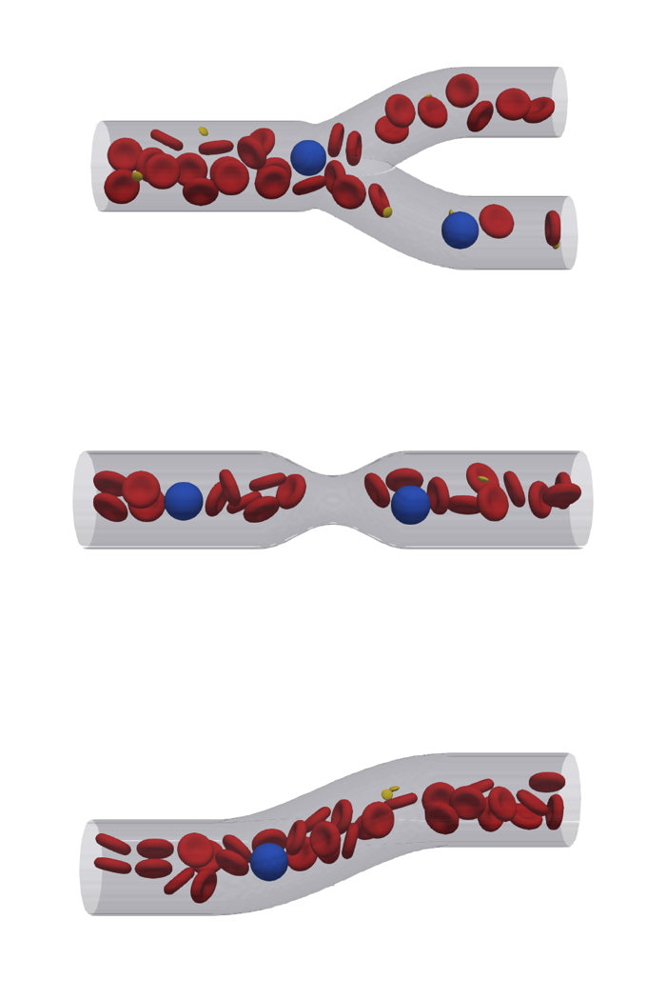

# vessel_geometries

Static previews of a cell packing (RBC, PLT, WBC) in three parametric vessels:
a bifurcation, a stenosis and an S-bend. The driver voxelises the STL, places
the cells, writes one output and stops; no fluid steps are taken. It is the
check before running flow in these geometries (with a pre-inlet, see
`cases/wbc_preinlet`).



## Run

From the repository root, build once (and `tools/packCells`, see
`doc/user_guide/packcells.rst`):

```bash
cmake --build build-dev --target vessel_geometries --parallel 4
cd cases/vessel_geometries
./run_preview.sh bifurcation          # or stenosis, curved; [ranks] [packCells options]
```

Then open `output_<geometry>/RBC.xmf`, `WBC.xmf`, `PLT.xmf` and `Fluid.xmf`
in ParaView (XDMF3 reader). For the wall, run Cell Data to Point Data on
`Fluid`, then Contour `Boundary` at 0.5. The script writes `pack_<geometry>.log`
and `run_<geometry>.log`; check the `placed N of M` lines.

## Geometries

`scripts/geometry/make_vessels.py` (run by the script if the STL is missing;
`uv run scripts/geometry/make_vessels.py --help` for the parameters). All are
100 um long along +x, with flat inlet and outlet faces normal to x, a 20 um
inlet diameter and lie in the xy plane:

| | Default shape |
|---|---|
| `bifurcation` | parent 20 um, two daughters of 15.9 um (Murray's law), outlets 30 um apart |
| `stenosis` | 50 % radius reduction (75 % area), cosine profile, 30 um long |
| `curved` | S-bend: 15 um lateral shift over 50 um |

The STL starts at 0 and `<refDir> 0`, `<refDirN> = 100 um / dx` in the
configs, so the voxeliser maps a point p [um] to lattice node p / dx + 1. A
`.pos` position q [um] lands on q / dx, hence the packing offset of one dx.
Another diameter or length needs `refDirN` (and the box) to match; the
generator prints both.

## Packing: known limits

`packCells` packs boxes and cylinders only, so the script packs the STL's
bounding box and HemoCell drops every cell with a vertex outside the fluid or
closer than `setInitialMinimumDistanceFromSolid()` to the wall. In a 20 um
vessel an 8 um cell must lie within about 5 um of the axis, so only 10-15 %
of the packed cells are kept: the lumen haematocrit is about 0.07 at a box Ht
of 0.3. A WBC fits only within a few um of the axis, so 30 (10 in the
stenosis, whose box holds fewer) are packed for 1-2 to be placed. Fine for
checking geometry and placement; for real runs feed the cells from a pre-inlet
(a straight cylinder, which packCells packs densely) or teach packCells the
lumen.
